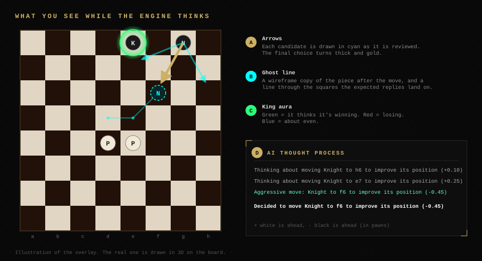
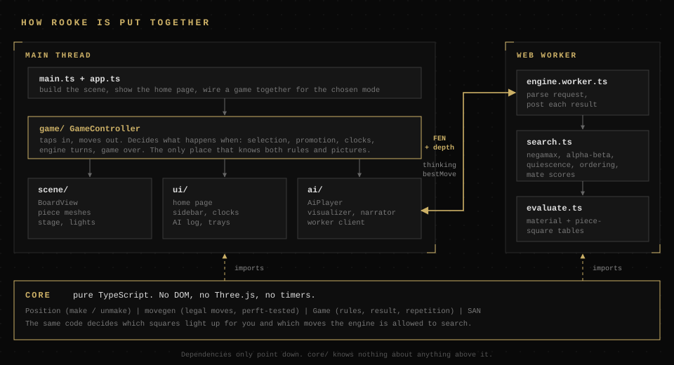
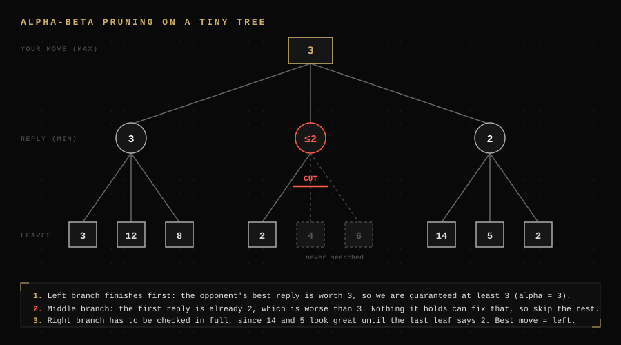
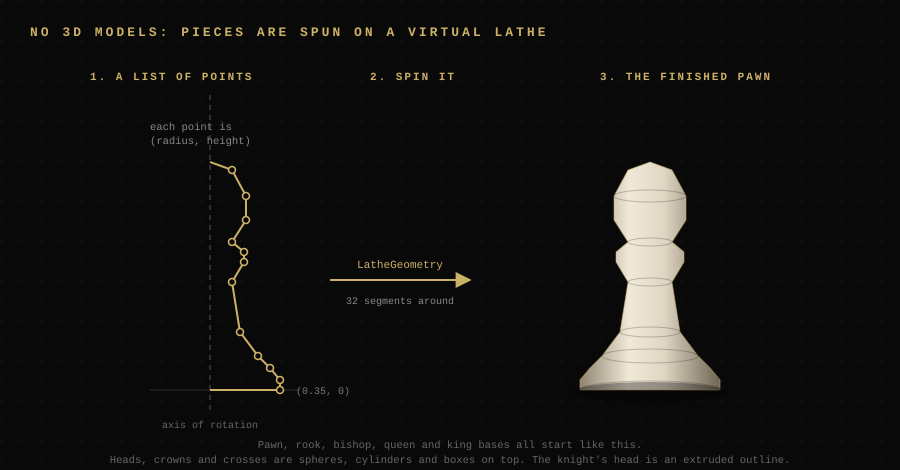

<div align="center">
  

  # Rooke

  **A 3D chess app that shows its work.**
</div>

---

## What this is

Rooke is a 3D chess game that runs in the browser, and the main point of it is that you get to watch the computer think.

Every chess engine I've played against felt like a black box. You make a move, there's a pause, and then it plays something that's either really smart or stupid, and you never find out why. I made this project mainly because I wanted to see inside that pause. So the engine narrates itself: every move it considers gets drawn on the board as an arrow, the line it's calculating shows up as a wireframe version of the chess piece, and a running log tells you what it thinks of each option and how good the position looks to it.

It's mainly for people who are still learning chess (me included) and want some visual intuition about the game.

2 game modes:

- **Versus AI.** You play white, the engine plays black, and all the "AI thought process" stuff is switched on. There's a button in the sidebar to hide it if you just want to play.
- **Sandbox.** No engine at all. Move both sides yourself, set up ideas, or play a friend on the same screen.

---

## Running it

```bash
git clone https://github.com/kaificial/rooke
cd rooke
npm install
npm run dev
```

That starts the Vite dev server. Open the `localhost` address it prints and you're in.

A few other scripts:

```bash
npm test          # unit tests for the rules, the engine and the clock
npm run typecheck # tsc, no emit
npm run build     # type-check, then make a production build in dist/
npm run preview   # serve that production build locally through Vite
npm start         # serve dist/ with the little Express server (server.cjs)
```

`npm start` only works after you've run `npm run build`, since it just serves whatever is in `dist/`.

---

## Playing

**Moving.** Press Start, then click one of your pieces and every legal square for it lights up. Click a lit square to move there. Captures, castling, en passant and pawn promotion all work. When a pawn reaches the far rank, a small picker pops up in the sidebar asking what you want it to become. You can't move before pressing Start, and you can't touch anything while it's the engine's turn.

**Camera.** The board is a real 3D scene, so you can look at it from anywhere. Rotate with left click and drag, zoom with the scroll wheel or trackpad, pan with right click and drag. It starts out looking at the board from white's side, and the camera can't dip below the board.

**Sidebar.** Start and Exit buttons, whose turn it is, a running move list in standard algebraic notation (`Nbd7`, `exd5`, `O-O`, `e8=Q#`), and the "Hide AI Thoughts" toggle (which disappears in sandbox mode since there's nothing to hide).

**Clocks and pieces.** Each side gets ten minutes. The clock at the top of the screen highlights whoever's turn it is, and the corners show the pieces each side still has on the board. If someone's time hits zero, the other side wins.

**How a game ends.** Checkmate, stalemate, the fifty-move rule, threefold repetition, insufficient material (like king versus king and a bishop) and running out of time are all detected, and the status line tells you which one it was.

---

## How the AI is visualized

This is the part I care most about, so it gets its own section. When it's the engine's turn, four things happen at once:

<p align="center">
  
</p>

1. **Arrows.** Each candidate move is drawn as a cyan arrow while the engine reviews it. When it finally decides, the arrow turns thick and gold.
2. **A ghost line.** The first move of the line it's calculating gets a wireframe copy of the piece on its destination square, and the replies it expects after that are traced as a line across the board.
3. **An aura around the black king.** A glowing ring that changes color with how the engine feels about the position: green when it thinks it's winning, red when it thinks it's losing, blue when it's roughly even. It follows the king around.
4. **The text log.** On the right side of the screen. It prints a line for each candidate ("Thinking about moving Knight to f6 to improve its position (-0.45)") and then a final "Decided to move..." line when it commits. The number is the evaluation in pawns: positive means white is better, negative means black is, and forced mates show up as "White mates in 3".

The engine searches way faster than anyone can read, so the pacing is handled on purpose. Candidates are replayed one at a time, about 0.8 seconds each, and if it finds more than about twenty, only the last handful are shown. After the final decision there's a two second pause before the piece actually moves, so there's time to take in the gold arrow instead of the piece just teleporting away. If you hide the thoughts, it skips all that and waits half a second.

The reasons in the log ("to control the center", "to capture White's knight") come from a few simple rules of thumb on top of the real search scores. The scores and moves are the engine's actual output. The "why" is a friendly gloss, so treat it as a narrator rather than a grandmaster explaining their reasoning.

---

## How it's put together

<p align="center">
  
</p>

Dependencies only point down, and `core/` knows nothing about anything above it.

- **`core/`** is the chess itself, in plain TypeScript with no DOM, no Three.js and no timers. It has the board (`Position`, which makes and unmakes moves in place), the move generator, a `Game` that tracks the things you can only know from history (the move list, repetition, the result) and standard algebraic notation. The UI and the engine both use this one implementation.
- **`engine/`** is the search, and it runs inside a Web Worker.
- **`scene/`** is everything Three.js: the stage (renderer, camera, lights), the board and piece models, and `BoardView`, which turns "this move happened" into animations. It knows nothing about the rules.
- **`ai/`** connects the engine to the screen: a typed client for the worker, `AiPlayer` (asks for a move, then replays the thinking at a readable pace), the narrator that writes the log lines, and the visualizer that draws the arrows, ghosts and aura.
- **`ui/`** is the DOM: the home page and the HUD (sidebar, clocks, AI log, piece trays). Styles live in plain CSS files in `styles/`.
- **`game/`** holds `GameController`, the one place that knows about both the rules and the pictures. It decides what happens when: you tapped a piece, here are its moves, you picked a square, play it in the rules, animate it, switch the clock, hand the engine its turn.

Splitting it up this way is as much about testing as tidiness. The rules and the search can be tested in milliseconds without a browser.

---

## How the engine works

The engine is in `src/engine/` and I wrote it from scratch, with no chess library. It runs in a Web Worker, which means the search happens on a separate thread. This matters a lot in a 3D app: if the search ran on the main thread, the whole scene would freeze every time the engine thought, and the orbit controls and animations would stutter. With the worker, you can keep spinning the board while it calculates.

<p align="center">
  
</p>

What's in it:

- **Negamax with alpha-beta pruning.** The classic approach. It tries every move, then every reply, and so on, assuming both sides play their best. Alpha-beta pruning lets it skip branches it can prove won't matter, which saves a huge amount of work.
- **Move ordering (MVV-LVA).** Alpha-beta prunes more when it looks at good moves first, so captures are searched before quiet moves, and among captures, "take a valuable piece with a cheap one" comes first. MVV-LVA stands for Most Valuable Victim, Least Valuable Attacker. A pawn taking a queen gets looked at before a queen taking a pawn. Promotions are looked at early too.
- **Quiescence search.** When the main search runs out of depth, it doesn't just score the position there, because that position might be halfway through a trade. Instead it keeps searching captures and promotions only, until things calm down. This fixes the classic "horizon effect." It's capped at 10 extra plies so it can't spiral.
- **Check extensions.** If the search would stop while a king is in check, it looks one ply further, so a mate right at the edge of the horizon gets seen as a mate. This is capped too.
- **Mate and draw scores.** Checkmate scores higher the sooner it happens, so the engine goes for the fastest mate and puts off getting mated. Stalemate and the fifty-move rule count as draws, which also means it won't throw away a winning position by stalemating you.
- **Evaluation.** Material first (pawn 100, knight 320, bishop 330, rook 500, queen 900), plus **piece-square tables** so a piece is valued for where it stands as well as what it is. Knights are worth more in the center and less on the rim, rooks like the seventh rank, kings want to stay tucked away early on. The tables are the standard "simplified evaluation function" ones from the chess programming wiki.
- **Fixed depth of 3.** The search goes three plies deep (plus quiescence). That's fast enough to feel snappy and strong enough to punish hung pieces and simple tactics, but it will lose to anyone who thinks more than a couple of moves ahead.

**How it talks to the UI.** The main thread sends the worker a FEN string of the current position and a depth. The worker searches every root move, and after finishing each one it posts back a `thinking` message with the move, its score, the line it expects, the node count and the elapsed time. That stream of messages is what drives the arrows, ghosts, aura and log. When it's done it sends a final `bestMove` message. Every message carries a request id, so a stale result from an abandoned search can never get played by mistake. The visualization isn't a recording or a simulation, it's the real search results as they come in.

One tradeoff I made on purpose: each root move is searched with a full window instead of sharing a narrowing one the way a normal engine would. That's slower, but it means every candidate gets an exact score, which makes the visualization more honest.

---

## How it was built

**The 3D scene** is Three.js. There are no imported models anywhere in the project. Every piece is built in code:

<p align="center">
  
</p>

- Pawns, rooks, bishops, queens and kings are mostly lathe geometry, which means I write down a 2D profile of half the piece (a list of radius and height points) and Three.js spins it around an axis to get a smooth turned shape, like on a wood lathe. Details like the pawn's head, the queen's crown and the king's cross are spheres, cylinders and small boxes stacked on top.
- Knights are the exception since you can't spin a horse. The head is an extruded 2D outline with a bevel, sitting on a lathe base and turned to face the right way for each side.
- Each piece type's geometry is built once and shared, so thirty-two pieces don't mean thirty-two copies of the same mesh data.
- The board is 64 beveled boxes sitting on a darker beveled base, with materials that have some roughness and a faint environment-map reflection so they catch the light a bit. A directional light casts soft shadows and an ambient light fills in the rest.
- Picking uses a raycaster against the click position. The lit-up target squares are checked before pieces, so clicking a square with an enemy piece on it captures it instead of selecting that piece.

**Animation** is GSAP. Pieces glide to their new squares with eased tweens, captured pieces shrink away, the rook swings across when you castle, the aura fades between colors, and the landing page rook bounces. GSAP does the tweening and Three.js just renders what it's told.

**Game rules** live in `core/` and are checked with perft, which is the standard test for move generators. It counts every position reachable to a given depth and compares the total against known-good numbers, so if castling, en passant, promotion or pins are even slightly wrong, the count is off. Rooke matches the published numbers for the starting position and four notoriously tricky test positions, and there are also tests for check, stalemate, draws, notation and the clock.

**The home page** is HTML and CSS with a dotted grid background, thin guide lines, bracketed corners on the tagline and rectangular buttons with a gold sweep on hover. The big rook is an isometric rook built from voxels and drawn as SVG polygons: I list the cubes layer by layer, sort them back to front, and draw three shaded faces per cube to fake the lighting. Each cube drops in with a staggered GSAP tween and lifts when hovered. The in-game HUD shares that look so going from the home page into a game doesn't feel like switching apps.

**Tooling.** Vite for the dev server and bundling (the worker is imported with `new Worker(new URL(...))` so Vite bundles it automatically, and Three.js gets its own chunk), TypeScript throughout in strict mode, Vitest for the tests, GitHub Actions running the typecheck, tests and build on every push, and a tiny Express server for serving the built files in production.

---

## Tech stack

| Layer | Tools |
|---|---|
| Language | TypeScript |
| 3D graphics | Three.js |
| Animation | GSAP |
| AI | Custom engine in a Web Worker |
| Styling | Plain CSS |
| Build | Vite |
| Tests | Vitest |
| CI | GitHub Actions |
| Production server | Express |
| Fonts | Space Mono and Inter (Google Fonts) |

---

## Project layout

```text
├── src/
│   ├── main.ts             # Entry point: builds the scene, shows the home page
│   ├── app.ts              # Wires a game together for the chosen mode
│   ├── config.ts           # Tunables: clock, engine depth, pacing, links
│   ├── core/               # Pure chess: Position, move generation, Game, notation
│   ├── engine/             # Search and evaluation, runs in a Web Worker
│   ├── scene/              # Three.js: stage, board, pieces, BoardView
│   ├── ai/                 # Worker client, AiPlayer, narrator, visualizer
│   ├── game/               # GameController, chess clock, tap input
│   ├── ui/                 # Home page and HUD components
│   └── styles/             # base.css, landing.css, hud.css
├── docs/                   # The diagrams used in this README
├── public/                 # Logo
├── .github/workflows/      # CI
├── index.html              # App shell and font links
├── server.cjs              # Express server for the production build
├── vite.config.ts          # Build and test config
├── package.json            # Dependencies and scripts
└── tsconfig.json           # TypeScript config
```

---

Kai Kim, 2025
